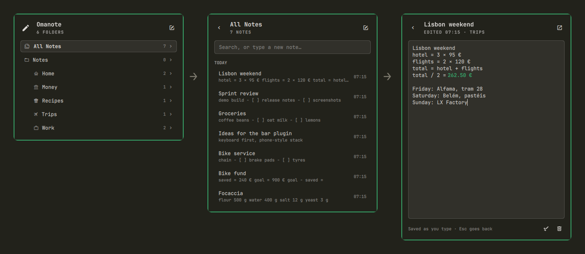

# Omanote for the Omarchy bar

A bar widget for [Omanote](https://github.com/TinyWorkshopDesign/omanote), the
quick-notes scratchpad for Linux, macOS, iOS and Android that syncs with Joplin Server
and looks like Omarchy.

> **This plugin needs the Omanote app.** The panel reads and writes notes through the
> app (its database, its sync with Joplin Server); on its own it shows nothing. Install
> the app first: see [Requirements](#requirements).



[](https://ko-fi.com/K8C82AR8S0)

The panel works like Omanote on a phone: a stack **Folders → Notes → Note**, with a
back arrow at the top left.

- **Click** the pencil in the bar to open the panel. It opens where you left it.
  - **Folders**: All Notes and the folder tree with note counts; a folder's Joplin emoji
    shows as the matching Omarchy-style glyph, as in the app. **↑ / ↓** (or j / k)
    and **Enter** open a folder; **n** starts a new note.
  - **Notes**: the folder's notes in date sections (Today, Yesterday, Previous 7 Days,
    Previous 30 Days, then months). Typing searches the folder; **↓ / ↑** pick a note,
    **Enter** opens it in the panel, **Ctrl+Enter** opens it in the app. **Enter** with
    no note picked saves the text as a new note in the folder (quick capture).
    **Ctrl+N** opens a new note in the panel. **←** on an empty field goes back to the
    folders; **Esc** clears the field, then closes the panel.
  - **Note**: the note, editable. It saves as you type; the first line is the title.
    Calculations show their results as in the app (`2+2=`, variables, `sum` / `avg` /
    `count` / `math` notes, `100 € in $ =` with the app's exchange rates). Images and
    sketches show in place; hover one to remove it from the note. **Esc** goes back to
    the list, **Ctrl+O** (or the icon at the top right) opens the note in the app,
    **Ctrl+S** saves at once. The bin moves the note to the trash (click it twice).
    Encrypted notes are read-only here.
  - **Draw** (the pen at the bottom, or **Ctrl+Shift+D**): a canvas with a short
    toolbar: pen (**P**), marker (**H**), eraser (**E**), four colours, size
    (**1**–**3**), undo (**Ctrl+Z**), clear. **Enter** (or the tick) inserts the drawing
    after the line with the cursor, **Esc** cancels. Click a sketch in a note to edit it.
    Drawings are saved like the app's: a PNG on the theme background with the strokes
    inside, so the app (and the panel) can reopen and edit them; other Joplin clients
    see the picture.
- **Right-click**: show or hide the Omanote window (`omanote --toggle`).
- **Middle-click**: new note in the app (`omanote --new`).

Notes are read and written through the app's command line (`omanote-cli` when it is
installed, otherwise the `omanote` app itself, which takes the same commands); it uses
the app's own database, so the app picks up changes immediately and syncs them with
Joplin.
The widget does nothing in the background; it reads the data when the panel opens.

The panel edits the note's Markdown as plain text around its images: checkboxes,
headings and rich text show as Markdown. Recently Deleted, new folders and sorting are
in the app only. Images are downloaded from Joplin Server the first time they show
(`omanote resource`), drawings are stored with `omanote sketch`.

The panel follows the language set in Omarchy (Setup > Region > Language) in English,
Italian, Spanish, French, German, Portuguese, Dutch and Polish; other languages show
English.

## Requirements

The **Omanote app**, 0.3.3 or later, with the `omanote` command on the `PATH`:

1. Download `Omanote_<version>_amd64.AppImage` (Intel and AMD) or
   `Omanote_<version>_aarch64.AppImage` (ARM) from the
   [latest release](https://github.com/TinyWorkshopDesign/omanote/releases/latest).
2. Put it in `~/Applications`, make it executable and link it as `omanote`:

   ```bash
   mkdir -p ~/Applications ~/.local/bin
   mv ~/Downloads/Omanote_*.AppImage ~/Applications/Omanote.AppImage
   chmod +x ~/Applications/Omanote.AppImage
   ln -sf ~/Applications/Omanote.AppImage ~/.local/bin/omanote
   ```

3. Start it once (`omanote`), sign in to your Joplin Server or choose to use it
   without a server. The AppImage updates itself from Settings → About.

A build from source (`omanote` and `omanote-cli`, see the
[main README](https://github.com/TinyWorkshopDesign/omanote#development)) works too.

## Install

```bash
omarchy plugin add https://github.com/TinyWorkshopDesign/omarchy-omanote.git --enable
```

Update it later with `omarchy plugin update tinyworkshop.omanote`.

To remove it (the app and your notes are not touched):

```bash
omarchy plugin remove tinyworkshop.omanote
```

With the widget installed, the Omanote app does not add its own tray icon on Linux,
so Omanote shows up once in the bar.

Summon the panel from a key binding with:

```bash
omarchy-shell shell toggle tinyworkshop.omanote
```

## Settings

`showPreview` (default on): the first lines of each note under its title; turn it off
to show titles only.

## Development

This repository is a copy of the `omarchy-plugin/` folder of
[TinyWorkshopDesign/omanote](https://github.com/TinyWorkshopDesign/omanote), published
with `tools/publish-plugin.sh`: open issues and pull requests there. `Calc.js` is the
app's calculator (`app/src/lib/calc.ts`) made to run in QML's JavaScript engine by
`tools/gen-plugin-calc.mjs`; do not edit it by hand. From a clone of the app
repository, `omarchy-plugin/install.sh` installs the working copy.

## License

MIT (see `LICENSE`). The icons are glyphs of the Nerd Font the Omarchy bar already uses;
nothing else is bundled. The only dependency is the Omanote app (MIT).

## Support

Omanote is free and open source (MIT). If it is useful to you, you can
[support it on Ko-fi](https://ko-fi.com/K8C82AR8S0).
